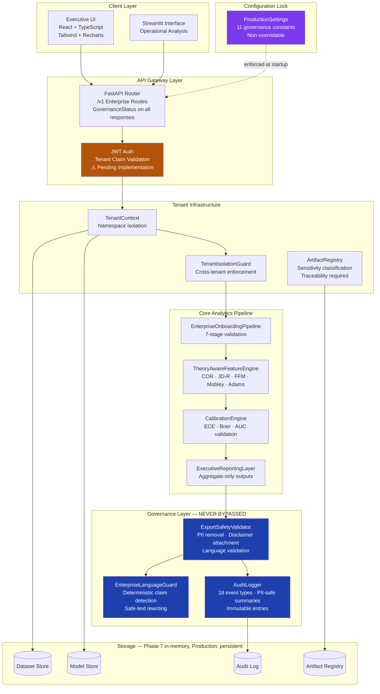
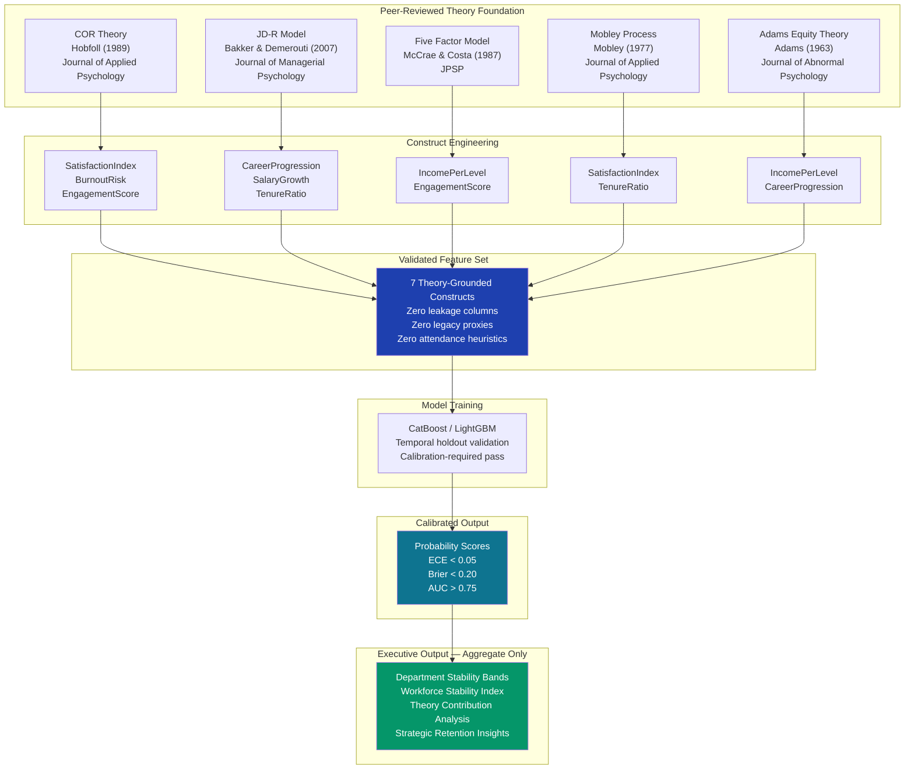
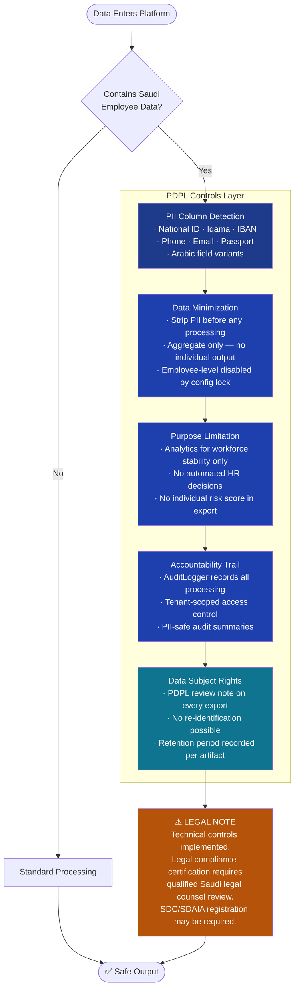
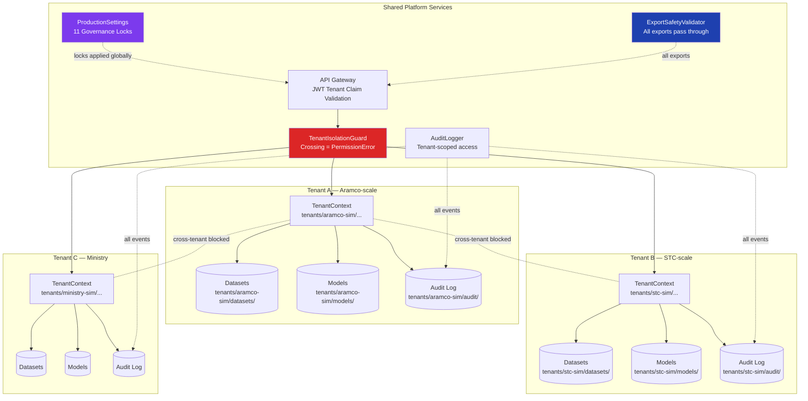
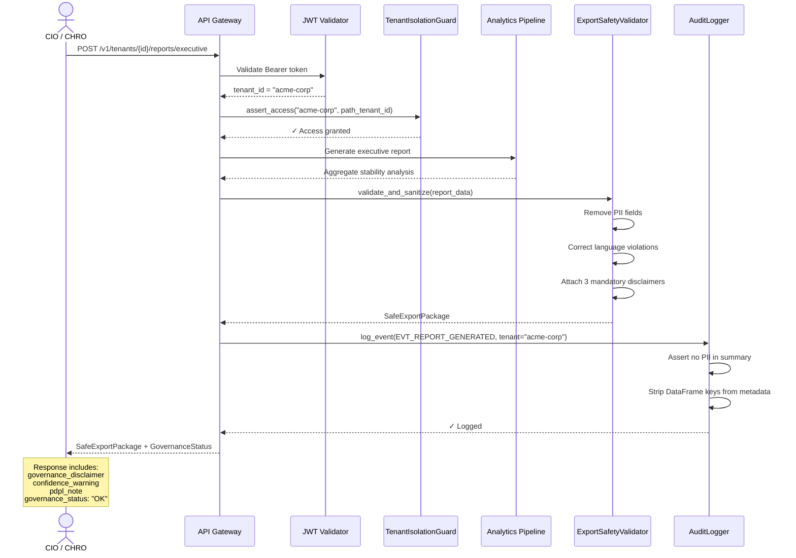

# Architecture Diagrams — Phase 8

**Document Type:** Visual Architecture Reference  
**Phase:** 8 — Executive Enterprise Presentation & Market Dominance  
**Date:** 2026-05-20  
**Format:** Mermaid diagrams (render with any Mermaid-compatible viewer)

---

## Diagram 1 — System Architecture Overview

---

## Diagram 2 — Governance Pipeline Flow

```mermaid
flowchart LR
    IN([Raw Dataset\nUpload]) --> S1

    subgraph "Stage 1: Schema Intelligence"
        S1[SaudiSchemaIntelligenceEngine\n· ERP detection\n· PII column scan\n· Leakage column detection]
    end

    S1 -->|Schema valid| S2
    S1 -->|BLOCKED| BK1([❌ BLOCKED\nSchema violation])

    subgraph "Stage 2: Saudi Data Governance"
        S2[SaudiDataGovernanceEngine\n· PDPL column screening\n· Arabic field detection\n· Nitaqat/Mudad support]
    end

    S2 -->|Governance OK| S3
    S2 -->|BLOCKED| BK2([❌ BLOCKED\nPDPL violation])

    subgraph "Stage 3: Temporal Validation"
        S3[TemporalValidator\n· Training/test split\n· Future-leakage prevention\n· Holdout window enforcement]
    end

    S3 -->|Valid| S4
    S3 -->|BLOCKED| BK3([❌ BLOCKED\nTemporal leakage])

    subgraph "Stage 4: Theory Compatibility"
        S4[TheoryAwareColumnMapper\n· COR construct mapping\n· JD-R construct mapping\n· FFM/Mobley/Equity constructs]
    end

    S4 -->|Compatible| S5

    subgraph "Stage 5: Calibration Validation"
        S5[CalibrationEngine\n· ECE threshold check\n· Brier score validation\n· AUC-ROC assessment]
    end

    S5 -->|Calibrated| S6

    subgraph "Stage 6: Language Safety"
        S6[EnterpriseLanguageGuard\n· Deterministic claim detection\n· Safe-text rewriting\n· Governance framing]
    end

    S6 -->|Safe| S7

    subgraph "Stage 7: Export Safety"
        S7[ExportSafetyValidator\n· PII field removal\n· Disclaimer attachment\n· PDPL note attachment]
    end

    S7 --> OUT([✅ SafeExportPackage\n+ GovernanceDisclaimer\n+ ConfidenceWarning\n+ PDPLNote])

    style S1 fill:#1e3a8a,color:#fff
    style S2 fill:#1e3a8a,color:#fff
    style S3 fill:#1e3a8a,color:#fff
    style S4 fill:#0e7490,color:#fff
    style S5 fill:#0e7490,color:#fff
    style S6 fill:#7c3aed,color:#fff
    style S7 fill:#7c3aed,color:#fff
    style OUT fill:#059669,color:#fff
    style BK1 fill:#dc2626,color:#fff
    style BK2 fill:#dc2626,color:#fff
    style BK3 fill:#dc2626,color:#fff
```

---

## Diagram 3 — Theory-to-ML Flow

---

## Diagram 4 — PDPL Compliance Flow

---

## Diagram 5 — SaaS Multi-Tenant Architecture

---

## Diagram 6 — Security & Audit Flow

---

*All diagrams represent the implemented architecture as of Phase 7/8. Authentication (JWT) is a placeholder pending implementation. Persistent storage is in-memory pending infrastructure integration.*
